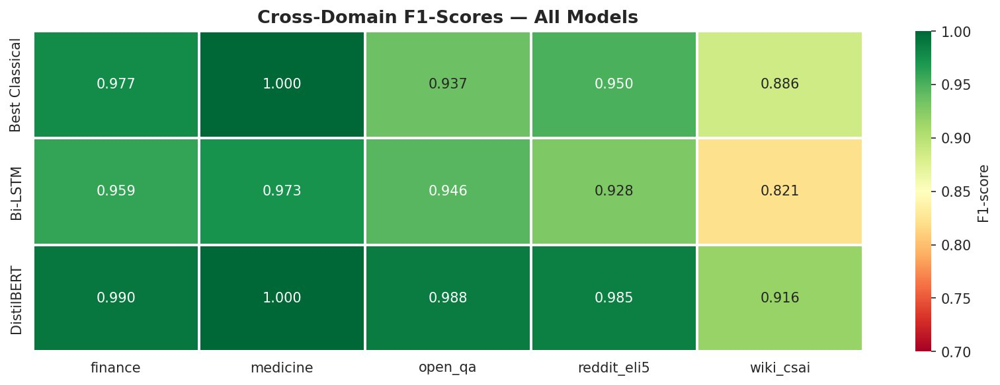

# AI-Generated Text Detection

A comparative study of classical, recurrent, and transformer-based approaches for detecting AI-generated text on the HC3 (Human ChatGPT Comparison Corpus) dataset, with a focus on cross-domain generalization, statistical rigor, and responsible deployment.

> **Headline result:** Fine-tuned DistilBERT achieves **F1 = 0.9847 / Accuracy = 0.9891 / ROC-AUC = 0.9998** on a held-out test set of 11,238 samples spanning 5 domains — but **aggregate metrics hide a 9.5% error rate on technical Wikipedia text**, raising serious fairness concerns for real-world deployment.

📄 **[Full technical report (PDF)](report.pdf)** · 🎓 [Presentation slides (PDF)](presentation.pdf)

---

## Why this project

The release of ChatGPT made AI-generated text indistinguishable from human writing for many readers, raising urgent questions in education, journalism, and content moderation. Detectors are increasingly deployed in high-stakes settings — but how well do they actually work, and on whom do they fail?

This project answers those questions empirically:

1. **How much does model architecture matter?** We benchmark 5 models across classical ML, RNNs, and transformers using identical splits and metrics.
2. **Does aggregate accuracy hide failures?** We disaggregate performance by domain and find disparities a 10× error gap that headline metrics conceal.
3. **Who is harmed by detector errors?** We document known biases against non-native English speakers (Liang et al. 2023) and propose deployment safeguards.

---

## Results at a glance

| Model | Accuracy | Precision | Recall | F1 | ROC-AUC |
|---|---|---|---|---|---|
| Logistic Regression (TF-IDF) | 0.9666 | 0.9508 | 0.9539 | 0.9523 | 0.9947 |
| Linear SVM (TF-IDF) | 0.9672 | 0.9513 | 0.9549 | 0.9531 | 0.9951 |
| Multinomial Naive Bayes | 0.9169 | 0.9362 | 0.8179 | 0.8731 | 0.9739 |
| Bi-LSTM (frozen GloVe-100d) | 0.9518 | 0.8968 | 0.9740 | 0.9338 | 0.9934 |
| **DistilBERT (fine-tuned)** | **0.9891** | **0.9706** | **0.9992** | **0.9847** | **0.9998** |

DistilBERT outperforms the strongest classical baseline by **~3.2 F1 points**, and the difference is **statistically significant** by McNemar's test (χ² = 144.0, p ≈ 3.55 × 10⁻³³).

But the more interesting story is in the **cross-domain breakdown**:

| Domain | Best Classical F1 | Bi-LSTM F1 | DistilBERT F1 |
|---|---|---|---|
| medicine | **1.000** | 0.973 | **1.000** |
| finance | 0.977 | 0.959 | 0.990 |
| open_qa | 0.937 | 0.946 | 0.988 |
| reddit_eli5 | 0.950 | 0.928 | 0.985 |
| **wiki_csai** (technical writing) | 0.886 | 0.821 | **0.916** |

DistilBERT's error rate on Wikipedia-style technical articles is **9.54% — over 10× higher than on medical text (0%)**, and ~9× higher than the project-wide average (1.09%). This pattern holds across every model architecture, suggesting the difficulty is intrinsic to the domain, not the model.



---

## Key takeaways

- **Classical models punch above their weight.** Linear SVM with TF-IDF reaches F1 = 0.953 — only 3 points behind DistilBERT — at a fraction of the compute cost. For latency- or cost-sensitive deployments, this matters.
- **Aggregate metrics are dangerous.** A reported "98.9% accuracy" sounds excellent until you see that 1 in 10 technical writers gets misclassified.
- **Bias is a feature, not a bug.** The same statistical signals that make detection work — formal phrasing, structured transitions, low lexical diversity — are exactly the markers of careful human writing in technical domains and of non-native English. The detector is doing what it was trained to do; the harm is structural.
- **Fairness audits should be standard.** This project ships with a dedicated ethics analysis (notebook 07) and 8 deployment recommendations. Most published detectors don't.

---

## Repository structure

```
ai-text-detection/
├── notebooks/
│   ├── 01_data_exploration.ipynb        # EDA + visualizations
│   ├── 02_preprocessing.ipynb           # Cleaning, dual pipelines, stratified split
│   ├── 03_classical_models.ipynb        # LR / SVM / NB with GridSearchCV
│   ├── 04_lstm_model.ipynb              # Bi-LSTM with frozen GloVe-100d
│   ├── 05_distilbert_finetuning.ipynb   # DistilBERT fine-tuning (HuggingFace)
│   ├── 06_evaluation_comparison.ipynb   # Master comparison + McNemar's test
│   └── 07_explainability_ethics.ipynb   # LIME, attention, bias audit
├── figures/                  # Pre-generated charts referenced in the report
├── report.pdf                # Full technical write-up (14 sections)
├── presentation.pdf          # Slide deck
├── requirements.txt          # Pinned Python dependencies
├── .gitignore
└── README.md                 # This file
```

The notebooks are designed to be run in order on Google Colab's free T4 GPU tier. Each notebook saves intermediate artifacts (splits, models, results) that the next one consumes.

---

## Reproducing the results

### Option 1 — Google Colab (recommended)

1. Open each notebook in Colab in order (01 → 07). Use **Runtime → Change runtime type → T4 GPU**.
2. The notebooks expect a Drive folder structure under `MyDrive/ai-text-detection/` with subdirectories `data/`, `models/`, `results/`, `final_results/`, `ethics/`, `glove/`. Notebook 01 creates these automatically on first run.
3. Run all cells. The dataset (HC3) is downloaded automatically via `datasets`. GloVe-100d is downloaded by notebook 04. The fine-tuned DistilBERT weights are saved to `models/distilbert_finetuned/`.

**Total runtime on Colab T4:** ~1.5–2 hours end-to-end.

### Option 2 — Local

```bash
git clone https://github.com/Elia43/ai-text-detection.git
cd ai-text-detection

python -m venv venv
source venv/bin/activate          # Windows: venv\Scripts\activate
pip install -r requirements.txt

jupyter notebook
```

A GPU is strongly recommended for notebooks 04 (LSTM) and 05 (DistilBERT). Without one, expect hours of CPU training rather than minutes.

### Reproducibility guarantees

- All random seeds fixed at **42** (Python, NumPy, TensorFlow, PyTorch).
- Stratified 70/15/15 split on the composite key `label × domain` (deterministic).
- Public dataset: [`Hello-SimpleAI/HC3`](https://huggingface.co/datasets/Hello-SimpleAI/HC3) on Hugging Face Hub.
- Trained model weights saved as artifacts; can be reloaded for inference without retraining.

---

## Dataset

**HC3 (Human ChatGPT Comparison Corpus)** — Guo et al., 2023.

- 24,322 paired Q&A items expanded to ~85,000 individual text samples
- 5 domains: `finance`, `medicine`, `open_qa`, `reddit_eli5`, `wiki_csai`
- AI source: ChatGPT (`gpt-3.5-turbo`)
- After quality filtering (removing texts <20 or >1000 words, deduplication): ~75K samples; test set 11,238

After unpacking each Q&A pair into individual samples, the human/AI split is approximately balanced. Domains are unevenly represented — `reddit_eli5` dominates with 8,727 test samples, while `wiki_csai` has only 241. We address this with stratified splitting on the composite `label × domain` key.

---

## Models compared

### Classical (notebook 03) — TF-IDF features (1–2 grams, 20K vocabulary)
- **Logistic Regression** with L2 regularization, C tuned via 3-fold GridSearchCV
- **Linear SVM** (`LinearSVC`), C tuned via GridSearchCV
- **Multinomial Naive Bayes** with Laplace smoothing, α tuned via GridSearchCV

### Recurrent (notebook 04)
- **Bi-LSTM with frozen GloVe-100d embeddings**
  - Architecture: `Embedding → SpatialDropout(0.3) → BiLSTM(128) → GlobalMaxPool → Dense(64, ReLU) → Dropout(0.5) → Sigmoid`
  - Trained with Adam (lr=1e-3), EarlyStopping (patience=3), ReduceLROnPlateau, batch size 128
  - GloVe is **frozen** to prevent overfitting given the modest training set relative to embedding parameter count

### Transformer (notebook 05)
- **DistilBERT (`distilbert-base-uncased`) fine-tuned for sequence classification**
  - Standard recipe: AdamW, lr=2e-5, linear warmup (10% of steps), weight decay 0.01, gradient clipping at 1.0
  - 3 epochs on a 15,000-sample stratified subset (transfer learning saturates quickly here)
  - Best checkpoint saved on validation F1

---

## Explainability

Notebook 07 produces three complementary views into model decisions:

1. **Global feature importance** (Logistic Regression coefficients):
   - Strongest AI markers: `important`, `including`, `help`, `even though`, `\nthe`
   - Strongest human markers: `url`, `etc`, `basically`, `thus`, `pretty`
   - The `url` signal is intuitive — humans link to sources, ChatGPT does not.
2. **LIME local explanations** for individual test instances, including a misclassified example where the model is fooled by AI-indicator vocabulary appearing in legitimate human writing about AI.
3. **DistilBERT attention visualization** at the final layer's `[CLS]` token, identifying which tokens drove the classification.

---

## Ethics & limitations

A full ethics analysis lives in notebook 07 and Section 11 of the [technical report](report.pdf). Headline findings:

**Domain bias.** Error rate ranges from 0% (medicine) to 9.54% (wiki_csai). Technical writers face disproportionate misclassification risk.

**Length bias.** Short texts (<50 words) have systematically higher error rates than longer documents — relevant because student work and short-answer questions are short by nature.

**Non-native English bias** (from prior work, not directly tested here). Liang et al. (2023) showed that >50% of TOEFL essays by non-native speakers were misclassified as AI-generated by popular detectors, vs. <5% for native speakers. The mechanism — lower lexical diversity, more formal phrasing, more uniform syntax — exactly matches the AI-indicator features our detector relies on. We have strong reason to believe our model exhibits the same bias.

### Eight responsible-deployment recommendations

1. **Never use as sole evidence.** Detection should be an informational signal; final high-stakes decisions require human review.
2. **Report calibrated probabilities, not binary labels.** `P(AI) = 0.83 ± 0.12` is honest; "this is AI" is not.
3. **Domain-specific calibration before deployment.** Test on the actual deployment distribution.
4. **Fairness audits across demographic and linguistic groups**, including non-native English writers, before any decision-making use.
5. **Avoid punitive use cases** (academic discipline, hiring screens). The harms of false positives outweigh benefits.
6. **Continuous re-training every 3–6 months.** Generators evolve; detectors decay.
7. **Transparency obligations.** Subjects should know they're being analyzed and be able to challenge results.
8. **Consider not deploying.** For some use cases, the most ethical choice is to not build the detector at all.

### Limitations

- Only ChatGPT (`gpt-3.5-turbo`) outputs tested. Performance on GPT-4, Claude, Gemini, or open-source models is untested.
- English only.
- Five domains is a narrow slice of real-world writing; news, fiction, academic papers, and code are not represented.
- No adversarial evaluation against paraphrasing attacks or human-in-the-loop editing.
- Static evaluation. Performance degrades as language models evolve.

---

## References

1. Guo, B., Zhang, X., Wang, Z., et al. (2023). [How Close is ChatGPT to Human Experts? Comparison Corpus, Evaluation, and Detection.](https://arxiv.org/abs/2301.07597) arXiv:2301.07597.
2. Sanh, V., Debut, L., Chaumond, J., & Wolf, T. (2019). [DistilBERT, a distilled version of BERT.](https://arxiv.org/abs/1910.01108) arXiv:1910.01108.
3. Liang, W., Yuksekgonul, M., Mao, Y., et al. (2023). [GPT detectors are biased against non-native English writers.](https://arxiv.org/abs/2304.02819) Patterns, 4(7), 100779.
4. Devlin, J., Chang, M.-W., Lee, K., & Toutanova, K. (2019). BERT: Pre-training of Deep Bidirectional Transformers for Language Understanding. NAACL-HLT 2019.
5. Pennington, J., Socher, R., & Manning, C. D. (2014). GloVe: Global Vectors for Word Representation. EMNLP 2014.
6. Ribeiro, M. T., Singh, S., & Guestrin, C. (2016). "Why Should I Trust You?": Explaining the Predictions of Any Classifier. KDD 2016.

---

## Citation

If you reference this work:

```bibtex
@misc{khater2026aitextdetection,
  author       = {Elia Khater},
  title        = {AI-Generated Text Detection: A Comparative Study of Classical, Recurrent, and Transformer-Based Approaches},
  year         = {2026},
  howpublished = {\url{https://github.com/Elia43/ai-text-detection}},
  note         = {Final project, Introduction to Natural Language Processing, Université Saint-Joseph (USJ), Spring 2026}
}
```

---

## Tech stack

- **Python** 3.10+
- **Notebooks**: Jupyter / Google Colab
- **Classical ML**: scikit-learn 1.3+, statsmodels (McNemar's test)
- **Recurrent**: TensorFlow / Keras 2.x
- **Transformers**: Hugging Face `transformers` 4.35+, `datasets`, PyTorch 2.x
- **Explainability**: LIME
- **Visualization**: matplotlib, seaborn, wordcloud

---

## Author

**Elia Khater** — Mathematics & Data Science, USJ Beirut
- 🔗 [github.com/Elia43](https://github.com/Elia43)

Final project for **Introduction to Natural Language Processing**, Université Saint-Joseph (USJ), Spring 2026.

---

## License

MIT License for the code in this repository. The HC3 dataset is licensed by its original authors (Guo et al., 2023) — please respect their terms when reusing this work.

## Acknowledgments

- **Hello-SimpleAI** for releasing the HC3 dataset publicly
- **Hugging Face** for the `transformers` and `datasets` libraries
